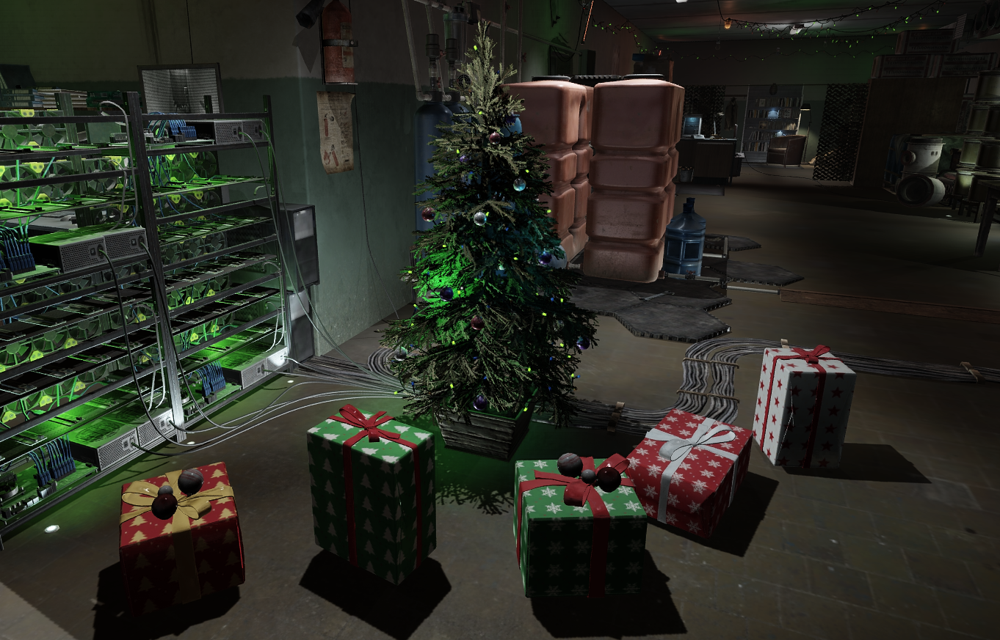
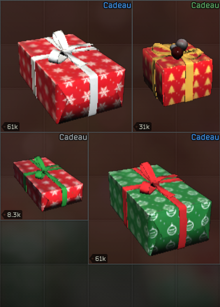

# 🎄🎁 Tushonka Christmas 🎁🎄

**Christmas comes to Tarkov.** Hidden gifts on every map, gifts tucked away in your hideout, an advent calendar on your wall, presents under the tree on December 25, and snow in your raids.

🎄 *For SPT 4.1.6 · by PraED-lab* 🎄

🎁 🎄 🎁 🎄 🎁 🎄 🎁 🎄 🎁

🎄 ━━━━━━━━━━ 🎁 ━━━━━━━━━━ 🎄

## ✨🎄 Features

### 🎁 Gifts in raid
- **20 gifts** are hidden on every map (adjustable from 1 to 30).
- They sit on the floor in places you can reach: never floating, never stuck in walls or furniture.
- Two choices on each gift:
  - **Open the gift**: the lid swings open and the item drops at your feet. Weapons are sent to you by message.
  - **Take the gift**: a game gift (small, medium or large) goes straight into your backpack, vest or pockets in one press, without dropping on the floor first. Unpack it later in your hideout. If you have no room, it stays at your feet.

### 🏠 Gifts in your hideout
- **3 new gifts every day**, hidden up high (shelves, cabinets, ledges) but always reachable.
- Their contents arrive by message.
- Gifts you open do not come back the same day.

### 🎄 Christmas morning (December 25)

- **5 gifts** wait on the floor in front of the hideout Christmas tree, on top of the 3 daily gifts.

### 📅 Advent calendar
- A 3D advent calendar hangs on your hideout wall, with a blinking red, green and white garland.
- Open it through the game's action menu: **one door per day, from December 1 to 25**.
- Day 25 is special: 3 gifts and a Tushonka (it is tradition).
- A door is only marked as opened once the server confirms your gift. If the server does not answer, you do not lose your day: just try again.
- Before December 1 the calendar is locked and shows "opens December 1".
- Move it anywhere: look at a wall and tick **"Advent calendar: move here"**. It hangs right there, facing you.

### 🎀 17 hand-made gift models
- 17 HD gift models with their own wrapping papers, ribbons and bows, picked at random on every map.
- The game's own Christmas gifts (small, medium and large) also wear these papers, in your stash, on icons and in inspection.
- A gift you take in raid **keeps the same paper** from the floor to your backpack.
- 🎃➡️🎁 **The large gift has been replaced**: in the base game it is a Halloween pumpkin. It is now a real Christmas gift with one of the 17 papers.

### 🎲 What is inside?
- A mixed draw across many item families, plus Tushonka, Christmas tree ornaments and Christmas surprises.
- The advent calendar has its own draw: no weapon parts, and food is limited to Tushonka, Alyonka, Slickers and alcohol (vodka, whisky, moonshine, beer, wine).
- Game gifts you take in raid are unpacked with the mod's draw (small 2 items, medium 4, large 6).

### ❄️ Snow
- During the season, each raid has a chance to be snowy.

### 🔔 Sound
- Opening a gift plays the hideout Christmas tree sound.

### 🌍 16 languages
- French, English, German, Spanish, Italian, Portuguese, Polish, Russian, Czech, Turkish, Hungarian, Romanian, Slovak, Chinese, Japanese and Korean.
- **Auto** follows your system language.

🎄 ━━━━━━━━━━ 🎁 ━━━━━━━━━━ 🎄

## 📆🎄 Season

| Period | What happens |
|---|---|
| 🎁 December 1 to 25 | Gifts in raid and in your hideout, advent calendar open |
| 🎄 December 25 | 5 extra gifts in front of the Christmas tree |
| ✨ December 26 to 31 | Decorations stay, no more gifts |
| 💤 Rest of the year | Mod asleep (unless "Active all year" is on) |

### Active all year
Want Christmas early, or in July? Turn on **"Active all year"** in the F12 menu: gifts and snow work right away.
The advent calendar stays locked until December 1, so its days keep their meaning.

🎄 ━━━━━━━━━━ 🎁 ━━━━━━━━━━ 🎄

## ⚙️🎁 Settings (F12 menu)

| Setting | Default | Description |
|---|---|---|
| Active all year | Off | Everything works all year round |
| Gifts hidden per raid | 20 | Number of gifts per map (1 to 30) |
| Advent calendar size | 0.55 | Calendar size (1 = 2.8 m wide) |
| Advent calendar height | 0.8 m | Height of the calendar above the floor |
| Advent calendar: move here | Off | Hangs the calendar where you are looking |
| Language | Auto | Mod language |

🎄 ━━━━━━━━━━ 🎁 ━━━━━━━━━━ 🎄

## 📦🎁 Installation

1. Download the zip.
2. Extract it into your SPT folder, next to `BepInEx`.
3. Start the server, then the game.

The zip contains:
- `BepInEx/plugins/TushonkaChristmas.Client.dll` (client)
- `user/mods/TushonkaChristmas/TushonkaChristmas.dll` (server)

**Both parts are required.**

🎄 ━━━━━━━━━━ 🎁 ━━━━━━━━━━ 🎄

## 🚀🎄 Performance

- Gift models and textures are loaded once and compressed.
- Gifts are placed once at the start of each raid, with no per-frame scanning.
- Icons are rendered once per model and size, then cached.
- No impact on FPS during normal play.

🎄 ━━━━━━━━━━ 🎁 ━━━━━━━━━━ 🎄

## 🔄🎁 Reset

- **Hideout gifts of the day**: close the game and delete `BepInEx/config/ChristmasGifts_hideout.txt`. Today's gifts and the tree gifts come back.
- **Settings**: delete the mod's config file in `BepInEx/config`. Everything returns to default.

🎄 ━━━━━━━━━━ 🎁 ━━━━━━━━━━ 🎄

## 🗑️🎄 Uninstall

Delete `BepInEx/plugins/TushonkaChristmas.Client.dll` and the `user/mods/TushonkaChristmas` folder.
The Christmas gifts already in your stash are normal game items. They stay and keep working, with their original look.

🎄 ━━━━━━━━━━ 🎁 ━━━━━━━━━━ 🎄

## ✅🎁 Tested on a fresh profile

This mod was tested on a brand new SPT 4.1.6 profile.

## ⚠️🎄 Disclaimer

This is a standalone mod, made by one person. I am not responsible for crashes, lost items or conflicts with other mods. Back up your profile before installing any mod.

🎄 ━━━━━━━━━━ 🎁 ━━━━━━━━━━ 🎄

🎁 🎄 🎁 🎄 🎁 🎄 🎁 🎄 🎁

🎄 **Merry Christmas, and enjoy your Tushonka!** 🥫🎁
